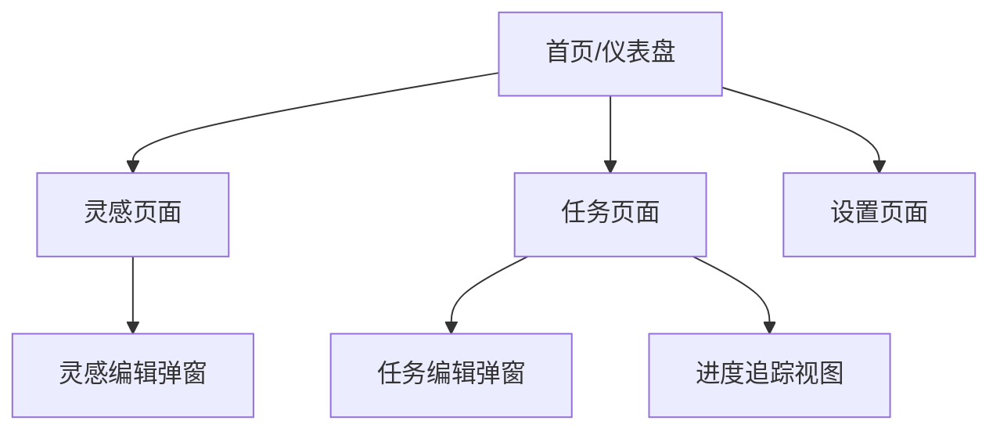

# 小梨Ai助手 - 产品需求文档

## 1. 产品概述

小梨Ai助手是一款智能个人管理Web应用，旨在帮助用户高效管理灵感、规划任务、跟踪进度，同时提供AI人格化互动体验。产品以"小梨"这一拟人化AI角色为核心，通过幽默风趣的吐槽互动，为日常管理工作增添趣味性。

- **目标用户**：需要管理创意灵感、规划日常任务、跟踪项目进度的个人用户
- **核心价值**：一站式个人管理 + 有温度的AI互动陪伴

## 2. 核心功能

### 2.1 用户角色

| 角色 | 注册方式 | 核心权限 |
|------|----------|----------|
| 普通用户 | 直接使用（无需注册） | 可使用全部核心功能，数据存储在本地 |

### 2.2 功能模块

产品包含以下核心模块：

1. **灵感记录系统** - 快速捕捉和整理灵感想法
2. **任务规划工具** - 创建和管理待办事项
3. **进度跟踪器** - 可视化任务完成进度
4. **AI人格化互动** - 小梨的吐槽和鼓励

### 2.3 页面详情

| 页面名称 | 模块名称 | 功能描述 |
|----------|----------|----------|
| 首页/仪表盘 | 概览卡片 | 显示今日任务、灵感数量、进度统计 |
| 首页/仪表盘 | 小梨互动区 | 展示小梨的随机吐槽或鼓励语录 |
| 灵感页面 | 灵感列表 | 展示所有记录的灵感，支持滚动加载 |
| 灵感页面 | 灵感编辑 | 创建、编辑灵感内容、来源、标签 |
| 灵感页面 | 标签筛选 | 按标签筛选灵感 |
| 任务页面 | 任务列表 | 展示所有任务，支持分类查看 |
| 任务页面 | 任务编辑 | 创建、编辑任务，设定优先级和截止日期 |
| 任务页面 | 进度追踪 | 可视化展示任务完成进度 |
| 任务页面 | 任务分类 | 按状态（待办/进行中/已完成）筛选任务 |
| 设置页面 | 主题切换 | 切换浅色/深色主题 |
| 设置页面 | 数据管理 | 导出/导入数据，清除数据 |

## 3. 核心流程

### 3.1 用户操作流程

**主要用户流程：**

1. 用户打开应用 → 进入仪表盘 → 查看今日概览
2. 用户点击"灵感" → 添加新灵感 → 填写内容、来源、标签 → 保存
3. 用户点击"任务" → 创建新任务 → 设定标题、优先级、截止日期 → 保存
4. 用户完成任务 → 标记完成 → 进度自动更新
5. 用户与小梨互动 → 查看随机吐槽 → 可刷新获取新语录

### 3.2 页面导航流程

## 4. 用户界面设计

### 4.1 设计风格

- **主色调**：温暖橙色 (#FF8C42) 为主色，浅灰 (#F5F5F5) 为背景
- **辅助色**：深灰 (#333333) 用于文字，浅蓝 (#4A90D9) 用于强调
- **按钮风格**：圆角按钮 (border-radius: 8px)，悬停时轻微上浮效果
- **字体**：使用系统默认字体栈，主要文字 16px，标题 24px
- **布局风格**：卡片式布局，顶部固定导航栏
- **图标风格**：简洁线条图标，使用 Emoji 增强趣味性

### 4.2 页面设计概览

| 页面名称 | 模块名称 | UI元素 |
|----------|----------|--------|
| 首页/仪表盘 | 概览卡片 | 白色卡片，圆角阴影，三个统计数字并排 |
| 首页/仪表盘 | 小梨互动区 | 圆角对话框样式，模拟聊天气泡，小梨头像 |
| 灵感页面 | 灵感列表 | 垂直列表，卡片式灵感项，标签以标签云形式展示 |
| 灵感页面 | 灵感编辑 | 底部弹出表单，包含文本框、来源输入、标签选择器 |
| 任务页面 | 任务列表 | 分组列表，按状态分组显示 |
| 任务页面 | 任务编辑 | 模态框表单，包含标题、优先级单选、日期选择器 |
| 任务页面 | 进度追踪 | 环形进度条或条形进度指示器 |
| 设置页面 | 设置项 | 列表式设置项，开关或按钮控件 |

### 4.3 响应式设计

- **桌面端优先**：主要针对桌面浏览器优化
- **移动端适配**：支持移动端浏览，布局自动调整
- **触摸优化**：按钮和可交互元素最小点击区域 44px