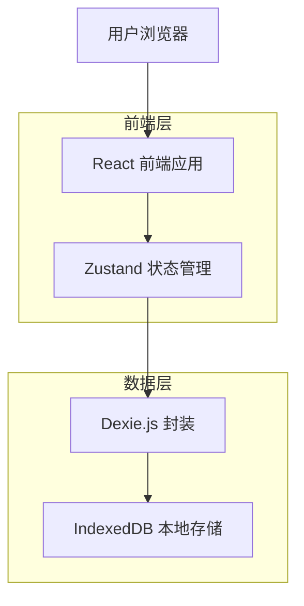
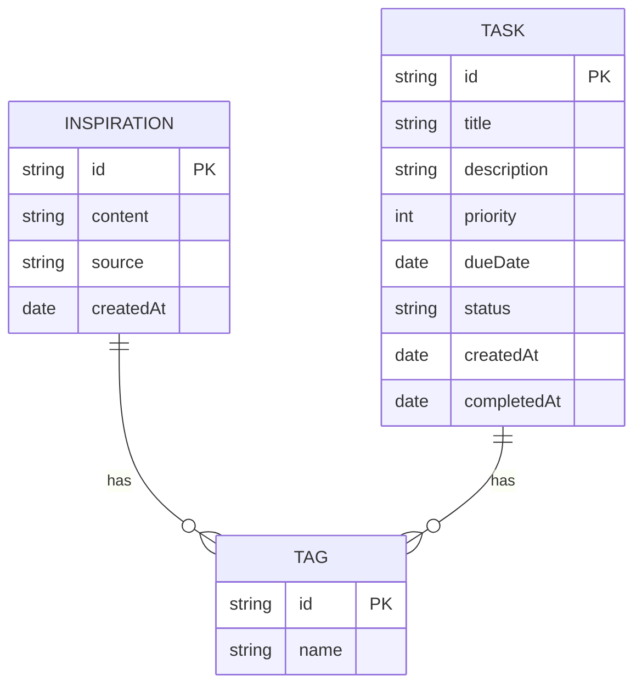

# 小梨Ai助手 - 技术架构文档

## 1. 架构设计



## 2. 技术选型

- **前端框架**：React@18 + TypeScript
- **构建工具**：Vite
- **样式方案**：TailwindCSS@3
- **状态管理**：Zustand
- **本地存储**：Dexie.js (IndexedDB 封装)
- **路由方案**：React Router (如需要)

## 3. 路由定义

| 路由 | 用途 |
|------|------|
| / | 首页/仪表盘，显示概览统计和小梨互动 |
| /inspiration | 灵感管理页面 |
| /tasks | 任务管理页面 |
| /settings | 设置页面 |

## 4. 数据模型

### 4.1 数据模型定义



### 4.2 数据定义语言

**灵感表 (inspirations)**
```typescript
// 使用 Dexie 定义表结构
db.version(1).stores({
  inspirations: '++id, content, source, createdAt, *tags',
  tasks: '++id, title, description, priority, dueDate, status, createdAt, completedAt',
  tags: '++id, name'
});
```

**任务状态枚举**
- `todo`: 待办
- `in_progress`: 进行中
- `completed`: 已完成

**任务优先级枚举**
- `1`: 低优先级
- `2`: 中优先级
- `3`: 高优先级

## 5. 组件结构设计

```
src/
├── components/
│   ├── common/          # 通用组件
│   │   ├── Button.tsx
│   │   ├── Card.tsx
│   │   ├── Modal.tsx
│   │   └── Input.tsx
│   ├── layout/          # 布局组件
│   │   ├── Header.tsx
│   │   ├── Navigation.tsx
│   │   └── Layout.tsx
│   ├── inspiration/     # 灵感模块组件
│   │   ├── InspirationList.tsx
│   │   ├── InspirationCard.tsx
│   │   └── InspirationForm.tsx
│   ├── task/            # 任务模块组件
│   │   ├── TaskList.tsx
│   │   ├── TaskCard.tsx
│   │   ├── TaskForm.tsx
│   │   └── ProgressTracker.tsx
│   └── xiaoli/          # 小梨互动组件
│       └── XiaoliChat.tsx
├── stores/              # Zustand 状态管理
│   ├── inspirationStore.ts
│   ├── taskStore.ts
│   └── settingsStore.ts
├── db/                  # Dexie 数据库配置
│   └── index.ts
├── pages/               # 页面组件
│   ├── HomePage.tsx
│   ├── InspirationPage.tsx
│   ├── TaskPage.tsx
│   └── SettingsPage.tsx
├── types/               # TypeScript 类型定义
│   └── index.ts
└── utils/               # 工具函数
    └── xiaoliQuotes.ts
```

## 6. 状态管理方案

使用 Zustand 进行状态管理，主要包含以下 Store：

### 6.1 灵感 Store (inspirationStore)
- `inspirations`: 灵感列表
- `addInspiration()`: 添加灵感
- `updateInspiration()`: 更新灵感
- `deleteInspiration()`: 删除灵感
- `filterByTag()`: 按标签筛选

### 6.2 任务 Store (taskStore)
- `tasks`: 任务列表
- `addTask()`: 添加任务
- `updateTask()`: 更新任务
- `deleteTask()`: 删除任务
- `completeTask()`: 完成任务
- `filterByStatus()`: 按状态筛选
- `getProgress()`: 获取进度统计

### 6.3 设置 Store (settingsStore)
- `theme`: 主题模式 ('light' | 'dark')
- `toggleTheme()`: 切换主题
- `exportData()`: 导出数据
- `importData()`: 导入数据
- `clearData()`: 清除数据

## 7. 核心功能模块说明

### 7.1 灵感记录系统
- 支持创建、编辑、删除灵感
- 为灵感添加来源和标签
- 支持按标签筛选灵感
- 数据持久化到 IndexedDB

### 7.2 任务规划工具
- 支持创建、编辑、删除任务
- 设定任务优先级（低/中/高）
- 设定任务截止日期
- 任务状态管理（待办/进行中/已完成）

### 7.3 进度跟踪器
- 统计任务完成百分比
- 按状态分组展示任务
- 可视化进度展示

### 7.4 AI人格化互动
- 预设小梨语录库（吐槽/鼓励）
- 随机展示语录
- 支持刷新获取新语录